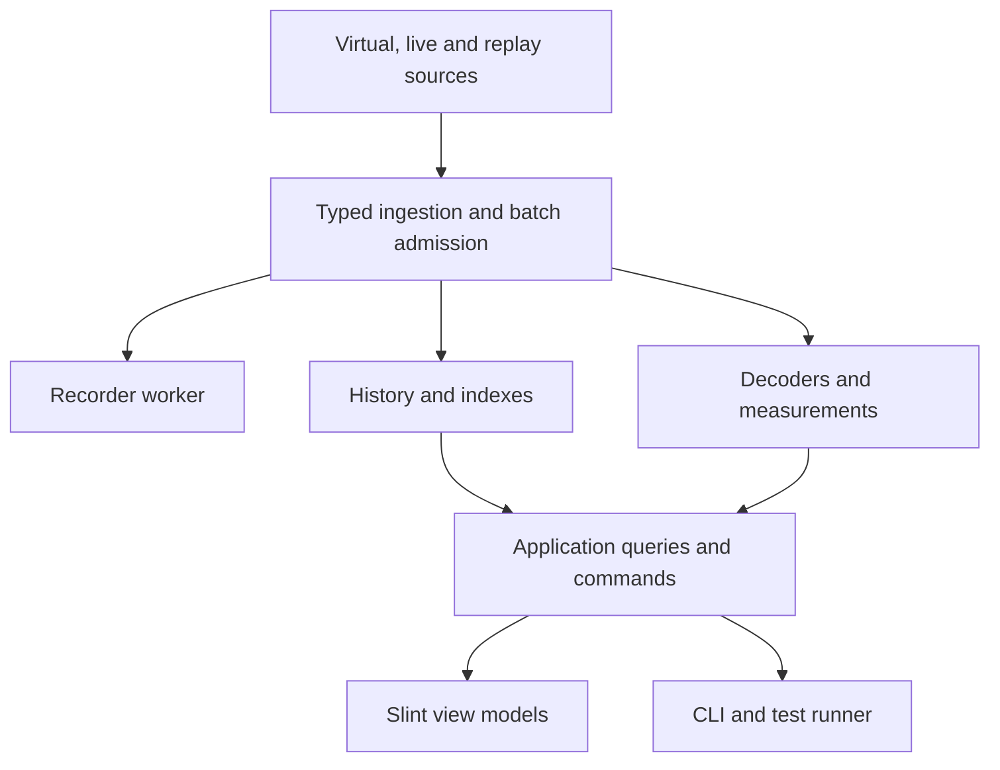

# Analysis release baseline and architecture review

**Status** Proposed · **Reviewed** 2026-11-24 · **Repository baseline** [`f6d16e98`](https://github.com/JannisRln/CANexus-Studio/commit/f6d16e98d95f3c614b81c2b24f252e96eab56756)

This proposal adds acceptance profiles to existing requirements. The [v0.6](11-decisions-v0.6.md) and [v0.7](17-decisions-v0.7.md) decisions govern product scope. The [implementation roles](../development/IMPLEMENTATION-ROLES.md) assign owners and evidence to the proposed increments.

[ADR-012](26-adr-012-egui-craft-ui.md) supersedes the target Slint/pbSlintDock host referenced in this baseline. The analysis workflow, data-path contracts and standard benchmark remain the comparison profile for egui migration. The new host's additional targets are in the [migration plan](../development/GUI-MIGRATION.md#benchmarks-and-measurement).

## Findings from the repository

| Finding | Design consequence |
|---|---|
| DEV-004 through DEV-007 supply typed CAN/CAN-FD frames, a virtual source, bounded batch fan-out and source-local Trace queries. History's inline byte limit does not cover batches retained elsewhere, allocator overhead or the whole process. | Preserve the existing frame, batch and query contracts. Implement lifetime-based batch accounting in DEV-023 and measure process memory separately. |
| DEV-003 proves the pinned Slint/pbSlintDock integration in a single window. Native floating windows, a production Trace and dynamic panel loading still need evidence. | Deliver the single-window workflow in DEV-008. Test native window lifecycle independently in DEV-022. Evaluate a public panel SDK after that proof. |
| ADR-009 and ADR-011 cover many failure modes. Their test scenarios lack a shared reference workload, firm measurement points and reproducible pass/fail budgets. Sparse batches currently need an explicit flush, and Trace pages borrow their records while scanning history. | Add deadline-based flushing in the capture worker and a bounded, cancellable query projection before enabling heavier views. Use the proposed benchmark profiles across the Core, GUI and recorder. Track test results against existing IDs. |
| The repository already separates personal layout, portable project resources, and machine-local hardware mappings. The design prototype covers the three principal workspaces. | Reuse the existing [design system](../design/DESIGN-SYSTEM.md). Keep the sample, capture state and portable projects usable with defaults and without proprietary hardware. |

The baseline CI run passed on the reviewed `main` commit. Native interaction, hardware behavior and the proposed performance targets require separate evidence. An open architecture review covers source-level remediation and confirms the same gaps in runtime identity, batch accounting and GUI composition. [GitHub Actions](https://github.com/JannisRln/CANexus-Studio/actions/runs/42575721608) · [Architecture review #21](https://github.com/JannisRln/CANexus-Studio/pull/21)

## What to bring over from the reference products

| Documented capability | CANexus-Studio proposal |
|---|---|
| AKJ7 CANExplorer offers a virtual bus and separate chronological and per-identifier views with search, bookmarks and change highlighting. | Ship a bundled demo and a focused Trace workflow. Keep chronological and Fixed views independent, with visible capture health and a raw/decoded Inspector. [CANExplorer overview](https://akj7.github.io/CANExplorer/) · [Trace guide](https://akj7.github.io/CANExplorer/user-guide/trace-and-overview/) |
| CANExplorer documents bounded recent history, temporary disk history, recording comparison and headless test reports. | Make disk history an explicit, byte-capped workspace option with a RAM fallback. Stage recording comparison after interoperable recording and indexed offline navigation. Use structured results with a JUnit export for GUI/CLI tests. [Trace guide](https://akj7.github.io/CANExplorer/user-guide/trace-and-overview/) · [CANExplorer overview](https://akj7.github.io/CANExplorer/) |
| Vector CANoe provides a central measurement setup, Trace, Statistics and Graphics views, and distinguishes analysis filtering from a measurement branch filter. | Start with a readable measurement setup showing source, capture policy, recording and decoding. Give every view its own display filter. Explicitly mark where a capture or recorder policy changes the dataset. [Vector CANoe feature matrix, pp. 5–6](https://www.vector.com/dam/jcr%3A712ee63e-f04a-42e8-84d7-149faf2cb4db/canoe-feature-matrix-en.2026-09-16-11-54-28.pdf) |
| CANoe combines simulation, desktop testing and server-side automation. | Share the virtual clock, service layer and test runner across desktop and CLI. Add stateful virtual ECU and restbus scenarios after the analysis pipeline and test contracts are verified. [Vector CANoe feature matrix, pp. 1–2](https://www.vector.com/dam/jcr%3A712ee63e-f04a-42e8-84d7-149faf2cb4db/canoe-feature-matrix-en.2026-09-16-11-54-28.pdf) |

The comparison uses public product documentation. It establishes workflow inspiration and leaves competitor throughput, memory use and implementation details unmeasured.

## Proposed release sequencing

| Increment | User outcome and acceptance gate |
|---|---|
| M1 · Virtual analysis | Open bundled demo offline and inspect live virtual CAN/CAN FD in a single-window Trace. Support the accepted chronological/Fixed modes and column sort/filter semantics. Provide selected-row details, capture status and independent Pause View and Stop Capture. Measure keyboard navigation and load behavior. DEV-008/009 deliver the slice and the reference run. DEV-023 supplies batch budget evidence. DEV-022 can proceed independently. |
| First usable analyzer · Windows and Linux | Live capture on at least one verified CAN-FD-capable adapter per OS, with a public adapter/driver capability matrix. Add DBC decoding and Signal Explorer, linked Plot/Inspector, byte and decoded-signal differences, per-channel statistics, persistent layouts, direct standard recording, and offline/virtual replay with pause, speed and seek. Verify the workflow on both platforms with demo, compatible hardware, and reference recording fixtures. Stage authorized manual transmit separately through DEV-012. |
| Diagnostics, measurement and automation | Add scoped ISO-TP/UDS and deterministic virtual ECUs, XCP/A2L measurement then guarded scalar calibration, CANopen monitoring then management, and isolated Python workers with shared GUI/CLI or CI test execution. A protocol profile, authorized fixtures and failure criteria gate each integration. Compare two recordings offline after indexing/clock alignment is verified. |
| Extended ecosystem | Validate a hardware/protocol/format SDK, native dockable panel SDK and optional Ethernet support through independent capability proofs. Keep CAN Signal Generator and XCP-driven generation post-v1 per DEV-DEC-005. Optional AI/MCP remains on its existing dependency track. |

### UX acceptance profiles

| Existing requirements | Proposed acceptance evidence |
|---|---|
| `REQ-UX-002/007/011`, `REQ-HAL-002` | **First run.** The welcome view offers Open Demo, Open Recording and Configure Device. In a moderated run, at least 5 of 6 engineers new to CANexus, covering both platforms, open the demo, filter to a specified ID and inspect its payload in under 2 minutes each with no help. The bundled demo is local, deterministic and visibly virtual. |
| `REQ-TRACE-001/002/014/018`, `REQ-UX-003/008` | **Trace.** Two views over the same capture keep independent filters, sorts and selection. Chronological follows source sequence by default and pauses following when the user jumps to a result. Fixed keys include session/source, logical network/channel, identifier format, frame class, ID and direction. Keep row placement stable while values update in the default ordering. Explicit column sorts follow ADR-009's acceptance profile. Selection tracks event or Fixed row identity across refreshes. Evicted events get an availability message and a route back to live. |
| `REQ-CAN-004/009`, `REQ-ARCH-011/028/032` | **State and quality.** Inspecting, scrolling, pausing display, changing filters or closing a panel leaves capture and recording state intact. The status bar labels source/mode, Capture, Recording, Display Pause and data gaps. Active filters declare their scope. Tests prove the same recorded event IDs with and without a display filter. |
| `REQ-TRACE-020`, `REQ-CAN-012`, `REQ-PLOT-004`, `REQ-TIME-001` | **Linked inspection.** Selecting a frame can move Inspector and Plot cursor within a linked group. The decoded value links back to the raw frame and its DBC interpretation. Time correlation carries provenance and uncertainty. Unsynchronized sources stay on separate time domains until a valid mapping exists. Voluntary linking preserves independent views. |
| `REQ-UX-004/005/007/009`, `REQ-PLG-014` | **Workspace.** Verify keyboard-only search, filter, navigation, selection and filter reset. Test focus restoration, accessible roles and state labels using a screen reader on each OS and 100%, 150% and 200% scaling. Light/Dark/System tokens and labels carry status with text or an icon as well as color. Save, restore and reset layouts outside ECU projects. Missing panels show a recoverable placeholder. Native floating adds monitor removal, DPI transition and redocking tests under DEV-022. |
| `REQ-TRACE-046/047/048`, `REQ-CAN-007/010`, `REQ-LOG-001` | **Offline.** Opening a log yields a cancellable index job and incremental pages. Separate progress, disk/cache failures and missing ranges are visible. View pause, seek and speed never activate physical replay. Search and seek a generated 10M-event fixture first, then the 100M-event scale fixture from ADR-011. Independently validate direct recording interoperability. |
| `REQ-TEST-001/003/004`, `REQ-SCR-022` | **Test execution.** The GUI and headless CLI execute the same deterministic Python test fixture with identical test identities and pass/fail counts. The CLI produces stable exit status and JUnit output with source references. Killing a script worker preserves capture, recording and another worker. |

### UI composition

Use the existing Fluent-based theme and design tokens. The first-run `Analyze` layout consists of an Explorer on the left, dominant Trace, optional Inspector on the right, and an always-visible status bar. A single top toolbar exposes source, start/stop capture, record, pause view, search and filter reset. Give filter chips and column menus a shared scope indicator and a keyboard path. Reveal advanced operations through contextual commands. Add Measure and Diagnostics as workspace presets of the same shell. They share source and status conventions and retain specialized content.

## Architecture refinements proposed for ADR-009/011

### Data path and memory

- Keep the Rust Core and Slint host in one process. The GUI sees paged view models via asynchronous, in-process calls. Use a bounded latest-result mailbox with one scheduled wakeup per view, coalesced refresh and generation checks on project, session and query. Capture and recorder work use separate scheduling. The CLI shares the application service contracts without depending on Slint.
- Stage capture batch publication by event count and a measured flush deadline so a single frame arrives promptly on a sparse bus. Use bounded query snapshots with a sequence high-water mark so appending new frames can leave an existing page valid. Report explicit invalidation when retention removes the requested range. Keep long scans off the capture and UI threads, and cap the raw data any query can pin while producing its projected page.
- Give each immutable event batch one memory reservation held until the last owner releases it. Include actual allocation capacity for inline payload, metadata and out-of-line payload blocks. Reserve before filling or publishing using nonblocking admission and bound staging by design. Views get capped pages of projected rows so ordinary navigation holds no raw batch handles. Use separate budgets for recorder staging, decoder/plot caches, UI page/render models, indexes and each worker. Charge cache/index data created after publication to its own budget. Keep accounted capacity, untracked platform allocations and measured process memory distinct. DEV-023 should test retained clones, all reorderings of drop, cancellation, producer fairness across sources and stop/restart. A slow reader must have an explicit quota and an observable gap or detachment policy.
- Preserve raw events, typed CAN/CAN FD batches, full timestamp provenance and source-scoped order. Index by source/generation and sequence, with explicit correlation mappings for time-domain views. Raw event IDs survive filtering, sorting and view recreation. Derived records retain decoder version and source IDs. Use viewport min/max envelopes with gap markers for plots. Exact cursor values and exports read the appropriate underlying samples.
- Define what happens at each capacity boundary. Driver-reported loss, admission rejection, history eviction, recorder gaps, decoder/script gaps and visual refresh coalescing have separate metrics. Known sequence ranges carry source, generation and reason. Unavailable driver counts remain unknown. A recorder queue overflow or finalization failure leaves the result explicitly incomplete/failed, with independently preserved diagnostic state. Closing a panel only releases its subscription. A blocked writer’s I/O and finalization are handled outside capture and UI.
- Default to bounded RAM history. Offer disk history as an explicit analysis option with retention and quota under the application cache directory. Keep it disposable and independent of the durable recorder. A full cache surfaces a diagnostic and falls back to RAM. Select the direct-recording format under DEV-013. MDF4 is a candidate under [ASAM MDF](https://www.asam.net/standards/detail/mdf/). Require external open/read of CAN and CAN FD fixtures with channel, direction, timestamp/clock mapping and payload fidelity, and disclose what metadata the format cannot represent. Treat ASC/BLF/MF4 readers and CSV export as separately evidenced capabilities.

### Extension and platform boundaries

- Built-in adapters, protocol decoders and file formats use typed Rust contracts and capability registration. Prove a second adapter and a non-CAN fixture against these contracts before freezing a public ABI. The non-CAN fixture exercises independent clock and variable-size payload handling while leaving the CAN fast path typed.
- Treat native extensions as trusted process code. Prototype an explicitly versioned native ABI with stable ownership rules, manifest negotiation and a compatibility test matrix. Version optional out-of-process adapters independently. Keep Python in lazy per-session worker processes with byte/item/concurrency caps, deadlines, explicit permissions and cleanup. Process separation alone provides crash containment for workers. Stronger restrictions on filesystem and network access require OS enforcement and separate tests.
- Keep panel view state in Rust keyed by stable panel ID, and session state in application services. Float/redock can recreate a Slint component. Evaluate native focus, accessibility, DPI, teardown and a missing-panel restore before committing to a dynamic panel SDK. The existing Slint/pbSlintDock combination is the starting point. If DEV-022 finds a blocker that persists after testing, benchmark a limited Qt Widgets docking prototype with the same Core service and fixture. [pbSlintDock](https://pbtechlab.com/project/pbslintdock/?lang=en) · [Qt docking state](https://doc.qt.io/qt-6/qmainwindow.html#saveState)
- Route real hardware actions through the same validated service/authorization boundary for GUI, CLI and scripts. Opening a project, restoring layouts, inspecting a log and replaying virtually leave transmit disabled. Device identity, logical channel and session generation bind any authorization. Device loss or project change invalidates it.

## Proposed performance and memory acceptance gates

Use the same reference hardware class on Windows and Linux, initially 6 physical cores or more, 16 GiB RAM, a local SSD and a 1920×1080 desktop at 60 Hz. Publish exact CPU, RAM, OS build, power mode, filesystem, GPU, driver, renderer/backend, UI scaling, toolchain, commit and fixture hash. Use release builds, seeded inputs and recorded workload timing. Use the deterministic virtual clock for correctness and real monotonic pacing for latency. Use a separate hardware suite at documented CAN bit rates and observed load.

| Profile | Proposed pass criterion |
|---|---|
| Baseline (`REQ-ARCH-005/006/009/035`) | Four synthetic logical channels, 50,000 aggregate events/s for 30 min at the ingress boundary, mixed 50% Classic 8-byte and 50% FD 64-byte frames, 1,024 distinct channel/format/ID/direction keys and fixed seed. Include a second run with a 100,000 events/s burst for 1 second every minute. Release build with two Trace views, one Plot at the analysis release, and recorder or a clearly identified M1 test sink. Expect zero observed ingress and recorder loss within the supported reference profile. Require ingress-to-publish p99 ≤ 5 ms in the sustained run and a sparse fixture at 1 event/s. Verify ingest and stored counts. Synthetic rates characterize software capacity. |
| UI (`REQ-UX-002/003/008/010`, `REQ-ARCH-027/028`) | Under baseline load, p95 input-to-visible feedback < 50 ms with at least 200 timed inputs, p95 live update age ≤ 150 ms, and p95 presented frame interval ≤ 20 ms during sustained scroll on the reference display. Measure startup to first interactive frame across at least 20 cold starts, p95 < 2 s with optional indexing still running. Record p99 and missed frames as diagnostics. Measure display presentation with platform instrumentation or display-backed UI evidence. |
| Memory (`REQ-ARCH-007/010/025`, `REQ-CORE-005`) | Start with a 64 MiB cap for shared batch backing memory inclusive of pinned references, 32 MiB for one recorder staging pool and no more than 2,048 projected rows per open Trace view. Enforce pool and page limits independently. On the baseline fixture, main process peak RSS on Linux or peak working set on Windows ≤ 350 MiB with optional workers disabled, and steady-state growth ≤ 32 MiB comparing medians at minutes 6–10 and 26–30. Report private bytes where available, worker totals when enabled, filesystem cache separately, and high-water marks by component. |
| Saturation (`REQ-ARCH-011/013/014/031/032`) | Stall UI and an optional decoder for 10 s. Acquire and record continuously within the reference workload and show independent decoder/view status. Separately stall the recorder until its queue saturates and inject a write/finalization failure. Verify incomplete/failed results, continuing capture, released budgets after consumers exit, and known gaps accounted for once. Test reconnect and stale queries under load. |
| Offline (`REQ-TRACE-045/047/050`, `REQ-ARCH-016/035`) | Use a generated 10M-event fixture, with seeded filters and prebuilt index for timing. p95 initial page and indexed seek ≤ 250 ms over at least 100 operations. Measure first-open indexing separately. Cancellation acknowledges within 100 ms and obsolete results never replace current views. Record peak memory and cap pages through the 100M-event scale case. |

Record three trials per long profile. Publish offered, admitted, recorded, dropped and evicted counts, queue occupancy, allocation/copy counts, throughput, p50/p95/p99 latency, frame pacing, memory and CPU. Use deterministic correctness and resource-limit tests in ordinary CI. Measure timing regressions on dedicated reference hosts with controlled load. Investigate any repeatable >10% regression versus the recorded reference on equivalent hardware before accepting a change. Budget values, supported hardware and format compatibility become release claims after acceptance and published results.
