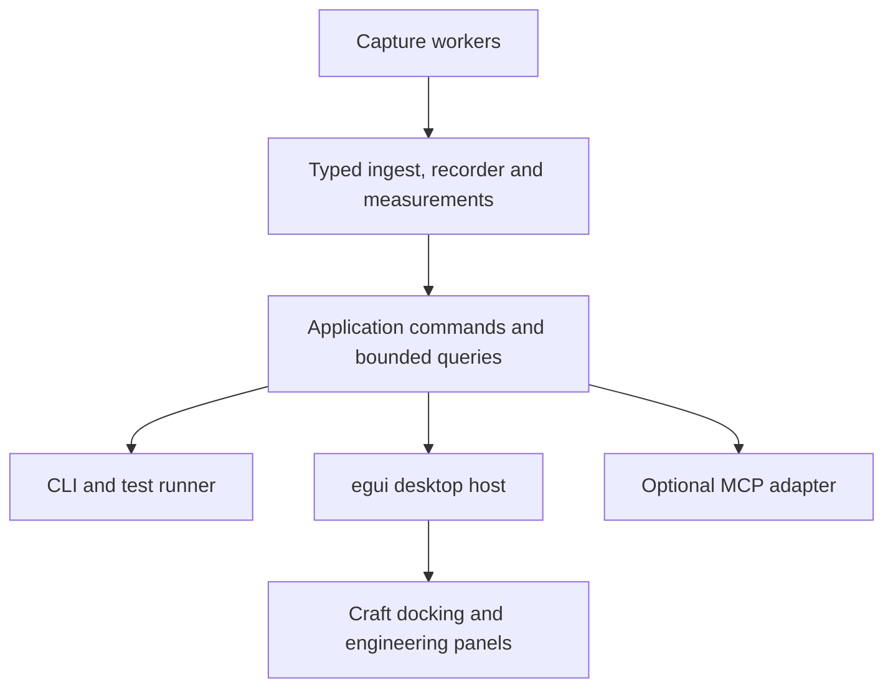

# ADR-012 — Desktop migration to egui and Craft UI

**Decision date** 2026-11-24 · **Direction** Accepted by the project owner · **Dependency pins and technical details** Proposed pending DEV-024

## Context and decision

CANexus-Studio targets an open-source, feature-rich Windows/Linux engineering desktop with predictable resource use. `main` at [`f158f3e`](https://github.com/JannisRln/CANexus-Studio/commit/f158f3eaac63e09ab93232387bb7b4aa69f3c620) contains typed CAN/CAN FD, a virtual fixture source, bounded ingestion, a RAM Trace primitive and the verified single-window DEV-003 Slint/pbSlintDock spike. The Rust CLI is a bootstrap executable. The production Trace, native floating lifecycle, recorder, installed device HALs and public panel SDK still require implementation and verification.

**Use egui as the desktop UI and eframe as the first native host candidate. Prefer `storytold/craft-libs` for reusable egui chrome and docking.** Select a Craft revision and exact egui family only after dependency, license and native-platform evaluation. Keep the verified spike as a comparison point through cutover. Preserve the modular, headless-capable Rust Core, existing typed capture path and one-process desktop composition.

| Option | Fit and decision rationale |
|---|---|
| Retain Slint and pbSlintDock | Verified single-window reference. The current integration needs C++20, pinned Slint and an extra build-time checkout and still has a native-window proof pending. Retain the evidence and portable workflow semantics through migration. |
| egui/eframe with Craft UI | Preferred direction. Rust-native app integration, shared toolbar/tab/icon/docking components and application-owned panel content match the target. Toolchain, framework-source identity, native floating and actual resource cost require validation. |
| egui/eframe with a pared-down workspace adapter | Bounded contingency if Craft docking gates fail. Compare built-in splits/tabs or an egui docking library on the same harness. Keep the CANexus layout schema and component interfaces usable across host implementations. |

## Runtime architecture

- Retain `canexus-core` as a safe Rust library. Introduce toolkit-independent application services inside the established workspace as proven use cases require. `canexus-gui` owns eframe, Craft adapters, scene/UI rendering and the platform event loop. `canexus-cli` owns headless composition. GUI, CLI, scripts and optional MCP invoke the same scoped commands, validation and query services.
- Use source/session/query generations, cancellable background queries and bounded projected pages. A latest-result slot per view coalesces repaint notifications. Only visible views request redraws at bounded rates, and an idle workspace sleeps until it receives input, a timer or new data. The GUI consumes view models outside the capture thread. File, hardware, indexing, recording and decoding operations run in their existing worker domains.
- Store panel instance, command and workspace IDs independently of toolkit widget IDs. A versioned CANexus layout stores panel placement and view state, with separate machine-local window geometry, device mappings and RAM/cache limits. The Craft adapter renders layout and returns transaction requests. Project configuration remains a portable, explicitly shared file; personal layouts and temporary data live outside ECU checkouts.
- Hold protocol sessions, recorders, measurement subscriptions and authorization outside panel objects. A floating viewport can be recreated or fall back in-window without changing those lifetimes. Restore validates monitor availability and scale. Invalid or missing plugin panels appear with recovery actions while preserving saved panel IDs and state.
- Select renderer and features by measurement. Compare native WGPU and Glow candidates with identical workloads where the selected stack supports both, and ship one default. Record backend, GPU/driver, renderer memory and software-renderer behavior. Use production feature flags that keep UI inspection, debug ports and provider integrations disabled by default.

## Extension and trust contracts

| Extension | Boundary and acceptance |
|---|---|
| Built-in hardware, transport, protocol, format, signal processing and simulation | Typed Rust traits and capability registration inside the app. Demonstrate a second provider and a non-CAN fixture before freezing public contracts. Allocate budgets per consumer and keep payload and timestamp provenance. |
| External adapter or algorithm | Start with explicit manifest fields for identity, contract version, dependencies, capability and permissions. Trusted native loading is a later versioned C-compatible ABI or equivalent, with documented ownership rules outside the safe Core. An isolated worker uses constrained versioned IPC and quotas for untrusted or crash-prone extensions. |
| Dockable panel or visualizer | Host renders validated panel schemas over a bounded query/command interface. Statically compiled trusted panels may use private egui adapters. Public contracts carry typed data, stable IDs, actions and view-state bytes with schema versions. DEV-026 verifies a separately built plugin, missing/incompatible layout restore, float/redock and teardown before SDK stabilization. |
| Python, automation, MCP and AI | Keep isolated Python worker sessions and versioned services. Run optional local stdio MCP through the same capability/permission model. Expose bounded read-only query/health first. A later active command requires matching session/device generation and explicit operator authorization in the application. Development-time UI inspection operates on virtual fixtures and remains outside the production bus control surface. [MCP design](24-ai-native-mcp-integration.md) |

## Requirements and supersession

The target toolkit choice supersedes Slint and pbSlintDock as the future GUI in the UX specification, ADR-010, ADR-011 and the analysis baseline. Those documents remain evidence for feature behavior, docking requirements and historical implementation. This ADR updates the toolkit-specific portion of the accepted `REQ-PLG-012`. Existing functional requirement IDs and their status stay in their canonical domain files. [v0.7 decisions](17-decisions-v0.7.md) · [UI plugins](16-ui-plugins-commands.md)

| Existing requirement | Migration acceptance |
|---|---|
| `REQ-UX-001/002/003/007/010/011/012` | Verify first-run and keyboard workflows with the native host. Verify bounded view models, idle repaint and responsive operation under load in DEV-008/009. |
| `REQ-UX-004/005/009/013`, `REQ-PLG-013/014` | Validate docking persistence, focus, native Windows/Linux lifecycle, high DPI, monitor removal, absent panels and stable measurement ownership in DEV-022/025/026. Publish an explicit per-backend capability matrix, including Wayland. |
| `REQ-TRACE-001/002/018`, `REQ-ARCH-027/028` | Preserve chronological and fixed modes, independent filters and sorting, and one bounded update path per view. Interpret the Slint references in ADR-011 as desktop presentation responsibilities fulfilled by egui adapters. |
| `REQ-CMD-001/006`, `REQ-TEST-001/004`, `REQ-AI-002/003/009` | Demonstrate common service entry points, deterministic headless/desktop parity, and least-privilege optional runtime MCP. The GUI, test harness and model providers have no direct capture handles. |
| `REQ-CORE-005`, `REQ-ARCH-007/010/035`, `REQ-LOG-001/003` | Run the existing throughput and bounded-memory profiles, including continuous recording and GUI load. The OS process-memory target describes a reference profile. User RAM settings and disk capacity are independent. |

## Required evidence before replacement

1. DEV-024 checks exact dependencies, Rust MSRV, licensing, Cargo source unification and headless dependency isolation. Run deterministic docking tests plus a display-backed smoke on Windows and Linux (X11 and Wayland where offered). Document which native-window capabilities are supported and the recovery path where compositor constraints apply.
2. DEV-025 gates production cutover on equivalent DEV-003 behaviors, a native component showcase, layout recovery and keyboard/accessibility tests. Update the workspace manifest, generated Slint build removal, `PBSLINTDOCK_ROOT`, packaging and CI together. Preserve the Slint baseline through its Git commit and legacy evidence.
3. DEV-008/009 connect the real virtual CAN-to-Trace path and compare baselines. DEV-022 verifies native floating independently, and DEV-026 owns the external panel proof. Publish actual benchmark and platform evidence in the [migration plan](../development/GUI-MIGRATION.md).
